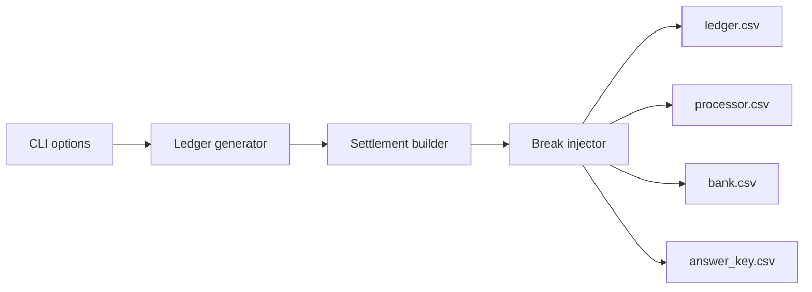

# recon-data-generator

Synthetic test data for **3-way reconciliation** in a cash-advance / neobank app:
internal ledger vs. payment processor vs. sponsor bank, with realistic breaks
injected and an answer key to score a recon engine against.

## Why
At a fintech I delivered 2-way reconciliation (app vs. processors) for cash advances.
The hard part is the third leg, the sponsor bank: long weekends, delayed ACH,
returns and duplicates. Real data can't be shared, so this tool creates
realistic data that can be.

## How it works


- **Advances** ($25–$500) pay out by instant transfer (1 business day) or ACH (2).
- **Repayments** are pulled back by ACH debit 7–14 days later.
- Settlement dates skip weekends and 2026 Federal Reserve holidays.

| Break | Real-world cause |
|---|---|
| late_bank_posting | Long weekends, bank cut-offs |
| missing_at_processor | Failed API call |
| missing_at_bank | Settlement file never received |
| amount_mismatch | Undisclosed processor fee |
| duplicate_at_bank | Re-sent settlement file |
| ach_return | R01 insufficient funds |

## Quick start
```bash
python3 -m venv .venv && source .venv/bin/activate
pip install -r requirements.txt
python3 generate.py            # 45 days, 8% breaks, seed 42
python3 generate.py --help     # all options
python3 -m pytest -v           # 5 tests
```

## Sample output
```
ledger.csv        1178 rows
processor.csv     1160 rows
bank.csv          1177 rows
answer_key.csv      94 rows
```

## Roadmap
- **v2:** collection retries, partial collections, fees/tips, more ACH return codes (R02, R10)
- **Next project:** an AI-assisted 3-way recon engine that matches these files
  and scores itself against `answer_key.csv`
